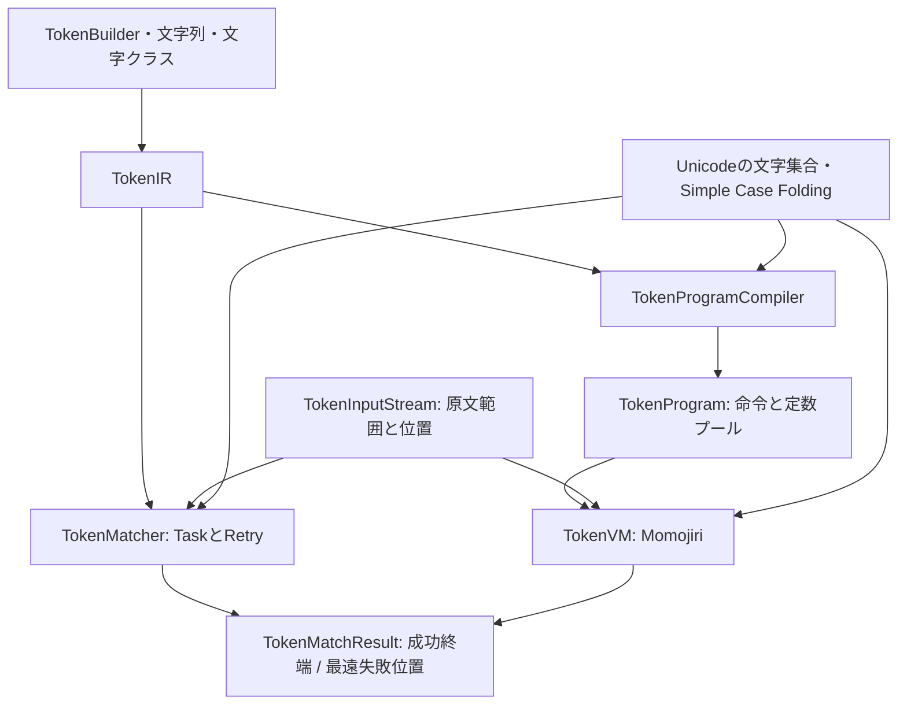

# SpelluLexのSwift実装設計

本書は、`103b8b2`時点のSpelluLexの実装を説明する。
字句の定義、文字クラス、入力、直接評価器、MomojiriのProgramとVMを対象に、
現在のSwiftの型と処理の対応をまとめる。
字句定義の利用者向けの書き方は[TokenBuilder.md](TokenBuilder.md)を参照する。

SpelluLexは、TokenIRで表された一つの字句パターンを入力位置から照合し、
成功の終了位置または最遠失敗位置を返す。
構文ルール、文法名、Triviaの自動挿入、構文木、SpelluErrorは管理しない。
これらはSpelluCoreなどの呼び出し側の責務である。

```swift
import SpelluLex

let bracketed: TokenIR = Sequence {
	"<"
	Character.notNewline.repeat(0..., behavior: .reluctant)
	">"
}
let number: TokenIR = ASCII.digit.repeat(1...)
let keyword: TokenIR = "while".ignoresCase()
```

## 1. モジュール構成と二つの実行方式

SpelluLexは独立したlibrary productであり、BasisとUnicodeCharacterDatabaseに依存する。
SpelluCoreと各構文エンジンがSpelluLexを利用する。
構文側のエンジンのバージョンと、字句側の実行方式は別である。

[TokenEngine](../Sources/SpelluLex/TokenEngine.swift)は、次の二つを持つ。

- `.interpreter`：TokenMatcherでTokenIRを直接評価する。
- `.momojiri`：TokenProgramをTokenVMで評価する。

この`.interpreter`は、構文のInterpreter v1・v2・v3の指定ではない。



主なファイルの担当は次のとおり。

- [TokenIR.swift](../Sources/SpelluLex/Grammar/TokenIR.swift)：
  字句の中間表現と反復behavior。
- [TokenBuilder.swift](../Sources/SpelluLex/Grammar/TokenBuilder.swift)：
  Builder、Sequence・ChoiceOf・Optional・Repeat、修飾メソッド。
- [Amount.swift](../Sources/SpelluLex/Grammar/Amount.swift)：数量の表現と範囲との変換。
- [CharacterClass.swift](../Sources/SpelluLex/Grammar/CharacterClass.swift)、
  [CharacterSet.swift](../Sources/SpelluLex/Grammar/CharacterSet.swift)、
  [CharacterPattern.swift](../Sources/SpelluLex/Grammar/CharacterPattern.swift)：
  文字クラスの定義と文字集合への変換。
- [TokenInputStream.swift](../Sources/SpelluLex/Runtime/TokenInputStream.swift)、
  [TokenInputStream+match.swift](../Sources/SpelluLex/Runtime/TokenInputStream+match.swift)：
  入力範囲、位置、共通の実行入口。
- [TokenMatcher.swift](../Sources/SpelluLex/Runtime/TokenMatcher.swift)：TokenIRの直接評価。
- [TokenProgram.swift](../Sources/SpelluLex/Runtime/TokenProgram.swift)、
  [TokenProgramCompiler.swift](../Sources/SpelluLex/Runtime/TokenProgramCompiler.swift)：
  Programのデータと生成。
- [TokenVM.swift](../Sources/SpelluLex/Runtime/TokenVM.swift)：
  命令の実行、後戻り、反復、確定範囲、単純反復の最適化。

## 2. 公開範囲と呼び出し側との境界

TokenIR、Amount、文字クラス、Builder、TokenEngine、TokenMatchResult、
TokenProgramはpublicである。
一方、TokenInputStream、TokenMatcher、TokenVM、TokenProgramCompilerはpackageの型である。
別パッケージの利用者へ、これらの実行器を直接操作する入口を公開した構成ではない。
TokenProgramの命令と定数プールも内部データである。

字句パターンは`import SpelluLex`だけで構築できる。
Spelluから照合する場合は、例えば次のようにTokenへ渡す。

```swift
import Spellu

let node: SourceNode = try "<x><y>".prefixMatch(
	engine: .v2,
	trivia: [],
) {
	Token {
		"<"
		Character.all.repeat(0..., behavior: .reluctant)
		">"
	}
}
assert(node.string == "<x>")
```

この例の構文エンジンはv2だが、字句照合はMomojiriへ渡される。
SpelluCoreのSourceStreamが、Sourceの範囲からTokenInputStreamを作って呼び出す。
成功位置を入力へ反映してSourceNodeを作るのは、構文側のscan処理である。

## 3. TokenIRとTokenBuilder

TokenIRはHashable・Sendableな値型で、次のデータを持つ。

- `factor`：文字集合、文字列、選択、連接のいずれか。
- `amount`：factorを繰り返す数量。
- `repetitionBehavior`：eager、reluctant、possessive。
- `caseInsensitive: Bool?`：大小文字設定。nilは外側から継承する。
- `expect: String?`：上位層の診断に使う表現。

Factorのsequenceとalternativeは、子に`[TokenIR]`を持つ。
数量とbehaviorは、Repeatだけの独立したノードではなく、どのfactorにも付けられる。
既定は数量1、behaviorはeager、大小文字設定はnilである。

TokenBuilderは文字列を`.string`、CharacterClassを`.character`へ変換する。
既存のTokenIRはそのまま渡す。
Swiftのif・if/else・forは、定義時にパターン配列を組み立てる処理となる。
照合中にSwiftのBuilderクロージャを繰り返し実行するものではない。

字句用の関数は次の形を作る。

- `Sequence`：子配列を1回評価するsequence。
- `ChoiceOf`：子を定義順に試すalternative。
- `Optional`：子配列のsequenceに数量0...1を付ける。
- `Repeat`：子配列のsequenceに指定数量とbehaviorを付ける。
- `Literal`：文字列をそのまま照合するstring。

`.repeat()`は元のfactorへ新しい数量を付け、既存の数量を置き換える。
修飾を連続しても、前の反復全体をさらに反復するノードにはならない。
反復を入れ子にする場合は、Sequence等で一段包む。
`.ignoresCase()`はfactorと数量・behaviorを保ち、大小文字設定を明示する。

`expect`はMatcherやVMの成功条件へは関与せず、Programにも照合命令として格納しない。
現在の`.repeat()`と`.ignoresCase()`はTokenIRを再構築する際にexpectを引き継がないため、
設定する順序まで含めて、呼び出し側で扱う必要がある。

## 4. Amountと実行時上限

AmountにはzeroOrMore、oneOrMore、zeroOrOne、exactly、nOrMore、upToN、rangeがある。
`min`は必須回数、`max`は有限上限またはnilを返す。
`RangeExpression<Int>.asAmount`は、Swiftの開区間・閉区間・片側区間をこの表現へ変換する。

`asRange(limit)`は無上限の数量を有限の閉区間にする。
有限上限はそのまま返し、無上限なら`max(min, limit)`を上端とする。
実行上限への切り詰めはMatcher・VM側の仕事であり、この関数では行わない。
`decrement`はList等の上位の変換でも使い、原則として数量から1を引く。

MatcherとVMは、`maxRepetition`を0以上`Int.max - 1`以下へ収める。
実行する反復の最大値は、文法の上限とこの設定値の小さいほうである。
文法の必須回数が設定値を超える場合は、不一致になる。
専用の安全停止エラーをthrowする仕組みではない。

上限に達しただけでは字句全体が失敗するとは限らない。
その回数で後続まで成立すれば成功し、後続が成立しなければ不一致になる。
この上限は各TokenIRの数量に適用し、全探索の総反復回数を合算するものではない。

TokenInputStreamのmatch入口の既定値は16384である。
上位のSpelluCoreは別途SafetyLimitsを持ち、通常は字句上限65535を渡す。
SpelluLex自体は、構文用のSafetyLimitsやその最小設定値を持たない。

AmountのcaseはIntを直接保持するため、負値や上下限逆転を型だけでは排除しない。
MatcherやCompilerは、それらの文法の意味検証を一式で行う入口ではない。
Spellu経由の検証は、上位のGrammarCheckerで行う。

## 5. 文字クラスとUnicode

CharacterClassは、利用者向けの文字集合の組み立てを担当する。
内部にCharacterSetを持ち、`asLexRule`で数量1のTokenIRへ変換する。
`Character.word`等は、SwiftのCharacterに追加したCharacterClassの生成APIである。

CharacterSetは`categories: [CharacterPattern]`と`inverted`を持つ。
各categoryの和集合を作り、必要なら全体を反転する。
include・excludeで複数のCharacterClassを組み合わせる場合は、
CharacterPatternの`.set`として内側の集合を保つ。

CharacterPatternは、全体、空白、改行、個別Scalar、Scalar範囲、
Unicode General Category、Binary Property、入れ子のCharacterSetを表す。
照合は[CharacterClass+match.swift](../Sources/SpelluLex/Runtime/CharacterClass+match.swift)、
集合としての展開は`asRangeSet`が担当する。

主な定義は次のとおり。

- `digit`：UnicodeのDecimal_Number。ASCII数字だけではない。
- `word`：Alphabetic、Mark、Decimal_Number、Connector_Punctuation、Join_Controlの和集合。
- `space`：Space_SeparatorとTAB。
- `newline`：LF、CR、Line_Separator、Paragraph_Separator。
- `ASCII.digit`：0...9。
- `ASCII.word`：ASCIIの英数字とアンダースコア。

ASCIIという名前のAPIを、すべて一律に0...127との積集合にする構造ではない。
例えば現在の`ASCII.newline`は、CharacterClass.newlineと同じ定義を使う。
それぞれの実体は[Character+.swift](../Sources/SpelluLex/Grammar/Character+.swift)で確認できる。

字句の実行単位はUnicodeScalarであり、書記素クラスタではない。
字句の1文字集合はScalarを一つ読む。
Characterを受け取る補助APIでは、CharacterPatternが単一Scalarかを確認して判定する。
文字列に対するCharacterSet.matchesは、先頭から一致するScalar数を返す。

## 6. 大小文字設定と原文位置

`caseInsensitive == nil`なら外側の値を継承し、true/falseならその要素で上書きする。
直接評価器はTaskに継承値を保持し、CompilerはProgram生成時に値を確定する。
子でfalseにした範囲が、後戻りによって親のtrueへ書き換わることはない。

文字列はUnicode Simple Case FoldingでScalar同士を比較する。
VMは文字列リテラルを事前にfold済みのScalar配列へ変換する。
文字集合は、個別Scalarならfold値を、範囲やUnicodeプロパティなら
Simple Case Foldingのvariantsを使って判定する。
反転は各カテゴリの照合後、CharacterSet全体で適用する。

全文の正規化や、複数ScalarへのFull Case Foldingは行わない。
例えば合成済みのéと分解形のe＋結合アクセント、ssとßを同一視する機構ではない。
一方、kとケルビン記号のようにUTF-8長が異なるSimple Fold一致は扱う。

一致終了位置と失敗位置は、正規化後の文字列ではなく原文のString.Indexである。
大文字小文字を無視した反復を戻す場合も、原文のScalar境界を使う。

## 7. TokenInputStreamとTokenMatchResult

TokenInputStreamは、`input: Substring`、`cursor: String.Index`、
`farthestFailure`を持つ値型である。
Substringは元の文字列のIndexを維持し、部分範囲でもその範囲を越えて読まない。
入力自体を一回の照合のために別の文字列へ切り直す必要はない。

`scanNext()`はUnicodeScalarを一つ読み、cursorを次のScalar境界へ進める。
UTF-8バイト数やSwiftのCharacter数を、そのままこの移動単位にするものではない。

結果の[TokenMatchResult](../Sources/SpelluLex/Runtime/TokenMatchResult.swift)は次の形である。

```swift
public enum TokenMatchResult: Equatable, Sendable {
	case success(String.Index)
	case failure(String.Index)
}
```

successは採用した一致の終端、failureは全試行の最遠失敗位置である。
Scalarの不一致はそのScalarの直前、入力不足はSubstringの終端を指す。
不一致位置を原文のUTF-8オフセットへ変換するのは呼び出し側である。

実行器ごとのmatch契約は次のように分かれる。

- TokenInputStream.matchは入力を進めず、値をコピーしたMatcherまたはVMを実行して結果だけ返す。
- Matcher・VM自身のmatchは、成功時にはその実行器のカーソルを進める。
- Matcher・VM自身のmatchは、失敗時には開始位置へ戻して最遠位置を返す。
- 各matchの開始時に最遠失敗位置を初期化し、前回の診断を持ち越さない。

入力末尾まで消費することは、SpelluLex単独の成功条件ではない。
全体一致やEOSの検査は、構文側の処理で追加する。

## 8. TokenMatcherのTaskとRetry

TokenMatcherはTokenIRを直接評価するが、Swift関数の再帰で子をたどる構造ではない。
`match()`のローカルに`tasks: [Task]`と`retries: [Retry]`を作って進める。

Taskは次を表す。

- `pattern`：数量と大小文字設定を解決し、factorの評価へ入る。
- `factor`：文字集合、文字列、選択、連接を評価する。
- `repetition`：次の一回を実行するか終了するかを決める。
- `repeated`：一回の成功後に回数と進捗を確認する。
- `endPossessive`：確定範囲内で保存したRetryを破棄する。

Taskは末尾から取り出す。
sequenceは子を逆順に積み、元の記述順に実行する。
alternativeは先頭を実行し、残りの候補を再試行用に逆順で積む。

Retryはカーソルと、その時点から再開するTask配列を持つ。
Task配列には外側の後続も含まれる。
候補が一度成功しても、その後続が失敗すれば候補内へ戻れる理由はここにある。
Task配列はSwiftの値として保存するため、後のTask変更は保存済みの候補と分離される。

処理に失敗したら最遠位置を記録し、最後のRetryからTaskとカーソルを復元する。
Retryがなければ照合全体を開始位置へ戻してfailureを返す。
Taskをすべて実行できれば、現在のカーソルをsuccessとして返す。

## 9. 選択・反復・無消費成功の共通意味論

ChoiceOfは記述順に試し、字句全体の残りが成立する最初の組合せを返す。
最長の字句を探索してから返す方式ではない。
Sequenceの内側の選択でも、外側の後続が失敗すれば再試行できる。

eagerは任意部分で本文を先に試し、終了する候補をRetryへ保存する。
後続が失敗すれば回数を減らし、本文内部の別の解釈も試せる。
reluctantは先に反復を終了して後続を試し、もう一回本文を読む候補を保存する。
後続が不成立の場合にだけ、その候補へ戻って反復を増やす。

possessiveはeagerの順に本文を評価し、範囲全体が成功したところで内部Retryを破棄する。
固定回数でも、その本文内部のChoiceOfへ後から戻らなくなる。
外側のChoiceOfの候補まで削除する処理ではない。

空文字列と空のSequenceは無消費で成功する。
空のChoiceOfは不一致である。
0回を許す数量なら、本文の不一致を反復終了として成功できる。
そのため、空のChoiceOfを0回以上反復するものと、空のChoiceOf自体は異なる。

一回の本文が無消費で成功したときは、必須回数を満たすまでは続け、
満たした後は反復を継続しない。
同じ位置で任意部分を無限に成功させることを防ぐ。
ただし、本文の別候補のRetryまで一律に捨てるわけではなく、
後続のために消費する候補へ戻る余地は残る。possessiveの確定は別である。

例えば字句`"a"*`の後に`"ab"*`を置き、入力をaabにすると、
eagerの最初の反復がaaを読んだ時点で後続も0回で成功できるため、結果はaaになる。
入力末尾のbまで読める組合せを探すためだけに、最初の成功を捨てることはない。

## 10. TokenProgramのデータと命令

TokenProgramはSendableな値型で、入力と実行中の位置を持たない。
すべてのフィールドはletであり、一つのProgramを独立したVMから再利用できる。

データは命令列と次の定数プールに分かれる。

- `predicates`：CharacterSetと確定した大小文字設定。
- `literals`：exactな文字列とUTF-8長、またはfold済みScalar配列。
- `atoms`：文字集合または非空リテラルへの参照。
- `repetitions`：最小・最大回数とbehavior。
- `loops`：反復仕様への参照と、判断・本文・退出の命令位置。

命令は定数の番号やジャンプ先を持ち、大きい文字列や集合を各命令へ複製しない。
主な命令は次のグループに分かれる。

- 照合：`matchClass`、`matchLiteral`。
- 分岐：`split(first:retry:)`、`jump`。
- 数量の確認：`requireLimit`。
- 一般の反復：`repeatEnter`、`repeatDecide`、`repeatBody`、`repeatNext`、`repeatLeave`。
- 単純な反復：`repeatAtom`。
- 確定範囲：`atomicEnter`、`atomicLeave`。
- 終了：`fail`、`accept`。

ProgramにはSourceNode生成やTrivia自動挿入、構文の優先順位比較を行う命令はない。

## 11. TokenProgramCompilerの生成手順

Compilerは設定`optimizeSimpleRepetitions`だけを保持する。
compileごとに新しいBuilderを作るため、前回の命令や定数を次回へ持ち越さない。
ProgramのキャッシュはCompiler自身では行わない。

Builderも再帰の代わりにTask配列を使う。
パターン、factor、命令の出力、ラベルの束縛をTaskとして積み、順に生成する。
大小文字設定はパターンへ入る段階で解決し、定数へ格納する。
最後にacceptを追加して、仮ラベルを実際の命令番号へ置き換える。

各TokenIRの入口には`requireLimit(amount.min)`を置く。
一つの非空文字列は、Scalarごとの多数の照合命令へ分解せず、matchLiteral一つにする。
例えば文字列日本語abcのProgramは、概念的には次の形になる。

```text
requireLimit(1)
matchLiteral(0)  // literals[0]に文字列とUTF-8長を保持
accept
```

alternativeは、候補の先頭と次候補をsplitで分け、
候補が成功したらjumpで選択の末尾へ合流する列を作る。
splitのRetryはVMに残るため、合流後の後続から別候補へ戻れる。
空のalternativeはfailとなり、空文字列のfactorは文字を読む命令を生成しない。

一般の反復は、Enter→Decide→Body→Next→Decide...→Leaveの小さなループにする。
有限回数が大きくても、その回数分の本文命令を複製しない。
最小・最大値はrepetitionsに置き、実行時に数える。
possessiveでは、その範囲をatomicEnter/Leaveで囲む。

単独のTokenIRのcompileと、配列を直接compileする入口がある。
空配列のProgramはacceptだけになる。
一方、空のsequenceを表すTokenIRは数量1の入口検査を持つため、
上限0での動作は空配列のProgramと同一ではない。

## 12. TokenVMの実行状態と後戻り

TokenVMは、stream、実行時上限、`pc`、Retry配列、Context領域、
現在のContextを指す`root`を持つ。
Programはmatchの引数であり、VMの入力や状態をProgramへ書き込まない。

match開始時は最遠位置とVM内部状態を初期化する。
命令をpcで読み、照合・分岐・反復を実行する。
acceptなら成功、失敗した命令があれば最遠位置を記録して`resume()`を呼ぶ。
再開先がなければ開始カーソルへ戻してfailureを返す。
成功・失敗とも、終了時にはRetryとContext領域を解放する。

### Context領域

Contextは親の番号とPayloadを持ち、配列`contexts`へ追記される。
Payloadは反復用のRepeatFrameか、確定範囲用のAtomicFrameである。
rootがnilなのは、現在の反復・確定範囲の親がない状態を表す。
必須の外部コンテキストを任意にしているものではない。

RepeatFrameは回数、実効最大値、その回の開始位置を持つ。
`replaceRepeat()`は保存済みFrameを書き換えず、同じ親を持つ新しい値を領域へ追加する。
以前のrootを持つRetryから、以前の反復回数を復元できる。

### Retryの保存と復元

Retryは、再開方法、カーソル、root、保存時のContext領域の長さを持つ。
通常の再開先は命令位置であり、単純反復では専用の再開方法も使う。
復元時はカーソルとrootを戻し、保存以後のContextを切り落とす。
最遠失敗位置はこの復元に含めない。

この方式では、選択のたびにContextの全配列を複製する必要がない。
一方、保存された経路が参照する過去のContextは領域に残る。
スタックの無制限な共有や、探索結果のメモ化を行う方式ではない。

## 13. VMの一般反復とpossessive

`repeatEnter`は実効最大値を持つRepeatFrameを積む。
`repeatDecide`は、必須回数未満なら本文へ、上限なら退出へ進む。
任意部分では、reluctantなら本文をRetryへ置いて退出し、
eagerなら退出をRetryへ置いて本文へ進む。

`repeatBody`は一回の開始位置を記録する。
`repeatNext`は成功回数を増やし、入力が進んだかを確認する。
進まなかった場合、必須回数を満たしていれば退出する。
`repeatLeave`は反復Contextを外し、後続命令へ進む。

AtomicFrameは、その範囲へ入る前のRetry数とContext領域長を保存する。
`atomicLeave`ではその範囲内のRetryだけを削除し、
rootを外側へ戻して、その範囲のContext領域も切り落とす。
本文が成功してこの命令へ来るまでは、本文内の選び直しは可能である。
後続へ抜けた後に、確定した範囲の内部へ戻らなくなる。

## 14. repeatAtomによる単純反復の最適化

Compilerの最適化が有効で、数量が1以外、factorが文字集合または非空リテラルなら、
一般の反復ループを`repeatAtom`一つへ置き換える。
choiceやsequence、空リテラルはこのAtomにはしない。
最適化を無効にしても同じ意味論を一般ループで評価できる。

eagerでは上限までAtomを読み、1回短くした位置へ戻るRetryを一つ保存する。
戻るたびに次の短い候補を追加するため、最初から全終端位置を配列に保存しない。
reluctantでは必須回数だけを読み、必要なら1回追加するRetryを一つ保存する。
possessiveでは後戻り用のRetryを作らない。
Atom自体に内部の選択がないため、これで確定を表せる。

`previousAtomBoundary()`は次の方法で1回前の位置を求める。

- 文字集合：原文の1Scalar前。
- exactリテラル：リテラルのUTF-8長だけ前。
- foldedリテラル：fold済みリテラルのScalar数だけ、原文を前へ戻る。

fold一致で原文のバイト長が違っても、固定バイト数で巻き戻さない。
これにより、ケルビン記号等を含む反復から後続へ戻る位置を保持する。

## 15. 最遠失敗位置と診断への接続

入力のカーソルと最遠失敗位置は独立している。
選択の失敗や反復の未完成部分から戻しても、recordFailureが記録した位置は戻さない。
failureを返す場合にだけ、その最大値を結果へ載せる。
別候補で成功した場合、結果は最遠到達位置ではなく、採用した候補の終了位置になる。

exactリテラルは、最初にUTF-8列を一括比較する。
成功なら終端へ進み、失敗した場合だけScalar単位で再走査して不一致位置を求める。
foldedリテラルはScalar単位でfold比較し、不一致Scalarの直前を記録する。
文字集合も、不一致だったScalarを消費済みの成功とは扱わない。

TokenMatcherには`onFailure(factor, start, failedAt)`がある。
失敗した文字集合・文字列、その要素の開始位置、失敗位置を巻き戻し前に通知する。
これは最終エラー一件の通知ではなく、探索中の各文字要素の失敗通知である。
複数の候補が同じ位置で失敗することも、先の候補だけが遠くまで進むこともある。
数量の上限検査や空の選択の失敗が、必ずこの文字要素通知になるわけではない。

VMは、この通知やExpectをProgramへ組み込まず、失敗位置だけを返す。
上位の[TokenIR+expect.swift](../Sources/SpelluCore/TokenIR+expect.swift)は、
その位置を元にMatcherで再探索し、同じ最遠位置の文字・未消費リテラルを収集する。
`ab`と`ac`が入力axで失敗する場合は、offset 1の期待値としてbとcを得る。
Expect型やunexpectedの行・列・ソートは、SpelluCore側に属する。

## 16. 上位エンジンとの接続・制約・テスト

Interpreterは字句IDごとにProgramをキャッシュし、
[共通のscan処理](../Sources/SpelluCore/Interpreter/Interpreter+scan.swift)から照合する。
SourceStream.matchは非破壊であり、成功した位置をカーソルへ反映するのはscan側である。
Wordのキーワード検査や、TokenとFragmentの前置Triviaの違いは、この上位層で扱う。

複数字句間の競合や構文Repeatのbehaviorは構文エンジンが扱う。

Matcher・VMは明示的な配列で探索し、CompilerもTaskで走査する。
それでも、後戻り候補数や総作業量に一般的な線形時間の保証はない。
maxRepetitionは、候補の総数・全体のメモリ量・総実行命令数の上限ではない。
パターンと入力に応じてTask、Retry、Context領域の量が増える。

TokenIR・TokenProgramは共有できるが、実行中のカーソルやRetryは評価器ごとに分ける。
同じ可変のVMを同時に実行する方式ではない。
部分入力の範囲とカーソルには、原文上の有効なScalar境界を渡すことを前提とする。

既存テストは、型ごとの検査と共通の意味論の確認に分かれる。

- [TokenMatcher](../Tests/SpelluLexTests/Runtime/@TokenMatcher.swift)、
  [TokenVM](../Tests/SpelluLexTests/Runtime/@TokenVM.swift)：
  開始・終了位置、失敗時の復元、再利用、部分入力、設定の補正と独立した実行器での共有。
- [TokenProgramCompiler](../Tests/SpelluLexTests/Runtime/@TokenProgramCompiler.swift)：
  命令と定数、ジャンプ先、最適化、反復回数によらないコード量。
- [共通意味論](../Tests/SpelluLexTests/@TokenMatching-Semantics.swift)：
  Matcher・汎用VM・最適化VMを同じパターン・入力・上限で確認する。
- [共通失敗位置](../Tests/SpelluLexTests/@TokenMatching-Failure.swift)：
  最遠位置、Unicode、選択・反復からの復元、部分範囲。
- [Amount](../Tests/SpelluLexTests/Grammar/@Amount.swift)、
  [文字クラス](../Tests/SpelluLexTests/Grammar/@CharacterClass.swift)、
  [Unicode数字](../Tests/SpelluLexTests/Grammar/@UnicodeDigit.swift)：
  定義データ、範囲変換と文字集合の意味。

深い入れ子や生成パターンの大量比較は、
[耐久テスト](../Tests/SpelluLexTests/Durability/@Token-Durability.swift)へ分離している。
通常の確認のために、その専用設定を有効にする必要はない。
